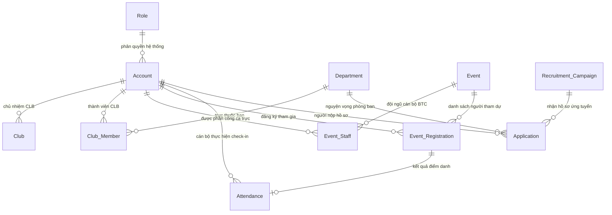

# EventFlow – Website Quản Lý Hoạt Động và Thành Viên Câu Lạc Bộ Tiếng Anh Sinh Viên

> **Môn học:** Quản lý Dự án Công nghệ Thông tin – Khoa Công nghệ Thông tin Kinh doanh, Trường Công nghệ và Thiết kế, Đại học Kinh tế TP. Hồ Chí Minh (UEH)  
> **Nhóm thực hiện:** Nhóm 8  
> **Project Sponsor:** TS. Nguyễn Mạnh Tuấn  
> **Phạm vi sản phẩm:** Minimum Viable Product (MVP) phục vụ nội bộ **01 Câu lạc bộ Tiếng Anh sinh viên (CLB BELL UEH)**  
> 🌐 **Live Demo Website:** [http://eventflow-ueh.duckdns.org/](http://eventflow-ueh.duckdns.org/) *(Triển khai trên Google Cloud Compute Engine, Ubuntu 22.04 LTS, Apache 2.4, PHP 8.2, MariaDB 10.4)*

---

## Mục Lục
1. [Tổng Quan Dự Án & Bối Cảnh](#1-tổng-quan-dự-án--bối-cảnh)
2. [Mục Tiêu Dự Án (Project Objectives)](#2-mục-tiêu-dự-án-project-objectives)
3. [Nhóm Người Dùng & Phân Quyền (Target Users & RBAC)](#3-nhóm-người-dùng--phân-quyền-target-users--rbac)
4. [Phạm Vi Sản Phẩm (MoSCoW & MVP Scope)](#4-phạm-vi-sản-phẩm-moscow--mvp-scope)
5. [Kiến Trúc Hệ Thống & Công Nghệ Sử Dụng (Tech Stack)](#5-kiến-trúc-hệ-thống--công-nghệ-sử-dụng-tech-stack)
6. [Thiết Kế Cơ Sở Dữ Liệu (Database Schema)](#6-thiết-kế-cơ-sở-dữ-liệu-database-schema)
7. [Danh Sách Màn Hình & Phân Hệ Chức Năng](#7-danh-sách-màn-hình--phân-hệ-chức-năng)
8. [Hướng Dẫn Triển Khai & Cài Đặt (Localhost & Google Cloud)](#8-hướng-dẫn-triển-khai--cài-đặt-localhost--google-cloud)
9. [Tiêu Chí Nghiệm Thu & Kiểm Thử (QA & UAT)](#9-tiêu-chí-nghiệm-thu--kiểm-thử-qa--uat)
10. [Đội Ngũ Phát Triển (Team Charter)](#10-đội-ngũ-phát-triển-team-charter)
11. [Tài Liệu & Liên Kết Dự Án](#11-tài-liệu--liên-kết-dự-án)

---

## 1. Tổng Quan Dự Án & Bối Cảnh

### Bài toán thực tế (Problem Statement)
Qua kết quả khảo sát định tính ban đầu (5 cuộc phỏng vấn sâu `P01–P05` với Ban chủ nhiệm, Thành viên CLB và Sinh viên tham gia sự kiện), quy trình vận hành hoạt động tại CLB đang bị phân mảnh trên nhiều công cụ rời rạc (`Google Forms`, `Google Sheets`, `Facebook Fanpage`, `Messenger`, `Danh sách giấy`), dẫn đến **5 Pain Points chính**:
1. **Thông tin đăng ký bị phân tán và cập nhật thủ công (`P01`):** Người tham gia thay đổi thông tin (như MSSV) qua Fanpage nhưng bảng tính check-in chưa kịp đồng bộ, gây tắc nghẽn khi đối chiếu.
2. **Thành viên dễ bỏ lỡ thông báo thay đổi sự kiện (`P02`):** Thay đổi địa điểm/thời gian trao đổi qua nhóm chat dễ bị trôi tin nhắn, dẫn đến sai sót khi truyền thông.
3. **Khó tra cứu lịch sử tham gia của thành viên (`P03`):** Ban chủ nhiệm phải mở đối chiếu 4–5 file danh sách rời rạc để tổng hợp lịch sử hoạt động của một thành viên trong học kỳ.
4. **Quá trình Check-in mất nhiều thời gian xác minh (`P04`):** Tra cứu thủ công trên Google Sheets hoặc giấy dễ xảy ra sai sót, điểm danh trùng hoặc khó xử lý nhanh người chưa đăng ký (khách vãng lai).
5. **Người tham gia không chắc chắn về trạng thái đăng ký (`P05`):** Sau khi điền Google Forms, sinh viên không rõ mình đã được ghi nhận giữ chỗ thành công hay chưa.

### Giải pháp đề xuất (Proposed Solution)
**EventFlow** là nền tảng website quản lý tập trung dành riêng cho **Câu lạc bộ Tiếng Anh BELL UEH**, giúp đồng bộ hóa xuyên suốt quy trình: **Quản lý thông tin CLB & Thành viên $\rightarrow$ Tuyển quân (Recruitment) $\rightarrow$ Tạo & Công bố sự kiện $\rightarrow$ Đăng ký tham gia (kiểm soát hạn & số chỗ) $\rightarrow$ Bàn Điều Hành & Phân công Cán bộ $\rightarrow$ Điểm danh thời gian thực (Check-in & Điểm danh vãng lai) $\rightarrow$ Báo cáo & Thống kê KPI hoạt động**.

---

## 2. Mục Tiêu Dự Án (Project Objectives)

| Mã | Mục tiêu dự án | Chỉ số đánh giá (KPI) & Mốc thời gian |
| :--- | :--- | :--- |
| **OBJ01** | Xác định và phân tích yêu cầu nghiệp vụ quản lý CLB sinh viên | Hoàn thiện phỏng vấn `P01–P05`, Requirement List (`FR01–FR20`, `NFR01–NFR07`), Use Case, BPMN và Product Backlog (`29 items`). **Mốc: M2 (22/10/2026)**. |
| **OBJ02** | Thiết kế và phát triển website quản lý CLB với các phân hệ MVP | Sign-off thiết kế Kiến trúc, ERD hoàn chỉnh và Prototype (**M3: 25/10/2026**). Hoàn thành 100% chức năng `Must Have` & phân hệ điều hành (**M4: 05/11/2026**). |
| **OBJ03** | Đảm bảo chất lượng và khả năng sử dụng của hệ thống | Thực thi tối thiểu **30 Test Cases**, tỷ lệ Pass mục tiêu **$\ge 90\%$**, **0 lỗi Critical** tồn đọng; tổ chức UAT với tối thiểu **5 người dùng** (**M5: 12/11/2026**). |
| **OBJ04** | Hoàn thành triển khai live demo và bàn giao hồ sơ dự án | Triển khai mã nguồn thành công lên máy chủ đám mây **Google Cloud Compute Engine** ([http://eventflow-ueh.duckdns.org/](http://eventflow-ueh.duckdns.org/)), bàn giao tài liệu phân tích - thiết kế - kiểm thử và hồ sơ đóng dự án (**M6: 26/11/2026**). |

---

## 3. Nhóm Người Dùng & Phân Quyền (Target Users & RBAC)

Hệ thống triển khai mô hình **RBAC 3 tầng chặt chẽ**, kết hợp giữa **Vai trò hệ thống (`Role`)**, **Vai trò tổ chức CLB (`Club_Member.MemberRole`)** và **Vai trò sự kiện (`Event_Staff.StaffRole`)**:

| Mã Actor | Vai trò (`RoleName`) | Mô tả & Quyền hạn chính trong EventFlow |
| :--- | :--- | :--- |
| **A4** | `System Administrator` | Quản trị tài khoản & hạ tầng: tạo tài khoản mới, kích hoạt / khóa tài khoản (`IsActive`), gán / đổi vai trò hệ thống (`FR17`). Bảo mật tuyệt đối, không can thiệp nghiệp vụ nội bộ CLB. |
| **A3** | `Club Manager` | Ban chủ nhiệm CLB (Chủ nhiệm & Phó Chủ nhiệm): toàn quyền truy cập **Workspace BĐH**, quản trị hồ sơ CLB (`FR05`), quản lý danh sách & trạng thái thành viên (`FR07, FR08`), quản lý chiến dịch tuyển quân & duyệt đơn ứng tuyển, tạo/sửa/hủy sự kiện (`FR09`), phân công Ban Tổ Chức sự kiện (`FR20`), vận hành Bàn điều hành Console và xem báo cáo thống kê chuyên sâu (`FR16`). |
| **A1** | `Club Member` | Thành viên chính thức của CLB: theo dõi tư cách thành viên, xem thông báo nội bộ, nhận ca trực khi được phân công vào Ban Tổ Chức sự kiện. **Đặc biệt:** Thành viên được phân công vai trò **`Check-in Lead` (Trưởng Bàn Điểm Danh)** sẽ được kích hoạt màn hình **Bàn Điểm Danh trực tiếp** để check-in và điểm danh vãng lai cho người tham dự. |
| **A2** | `Event Participant` | Sinh viên UEH & Khách tham quan: đăng ký / đăng nhập tài khoản (`FR01, FR02`), cập nhật hồ sơ cá nhân (`FR04`), xem thông tin CLB (`FR06`) & lịch sự kiện (`FR10`), đăng ký / hủy đăng ký sự kiện (`FR12`), nộp đơn ứng tuyển CLB và theo dõi lịch sử tham gia của bản thân (`FR13`). |

---

## 4. Phạm Vi Sản Phẩm (MoSCoW & MVP Scope)

### Phân loại Yêu cầu Chức năng (Functional Requirements)

| Mức ưu tiên | Mã FR | Tên chức năng | Backlog ID | Trạng thái |
| :---: | :---: | :--- | :---: | :---: |
| **Must Have** | `FR01` | Đăng ký tài khoản sinh viên UEH | `PB01` | **Hoàn thành** |
| **Must Have** | `FR02` | Đăng nhập, đăng xuất và kiểm soát phân quyền RBAC 3 tầng | `PB02, PB03` | **Hoàn thành** |
| **Must Have** | `FR04` | Quản lý hồ sơ cá nhân và tư cách thành viên | `PB05` | **Hoàn thành** |
| **Must Have** | `FR05` | Cập nhật hồ sơ & thông tin liên hệ Câu Lạc Bộ | `PB07` | **Hoàn thành** |
| **Must Have** | `FR06` | Xem trang thông tin công khai CLB (cơ cấu ban điều hành, 4 phòng ban) | `PB06` | **Hoàn thành** |
| **Must Have** | `FR07` | Quản lý danh sách thành viên (tra cứu, lọc theo ban, thêm, sửa) | `PB08, PB09` | **Hoàn thành** |
| **Must Have** | `FR08` | Quản lý vai trò (Member, Leader, President) & trạng thái thành viên | `PB10` | **Hoàn thành** |
| **Must Have** | `FR09` | Quản lý sự kiện (tạo mới, chỉnh sửa, hủy; tự động bảo toàn dữ liệu đăng ký) | `PB11, PB12` | **Hoàn thành** |
| **Must Have** | `FR10` | Danh sách sự kiện & Trang chi tiết sự kiện trực quan | `PB13, PB14` | **Hoàn thành** |
| **Must Have** | `FR12` | Đăng ký tham gia sự kiện (kiểm tra hạn chót, MaxCapacity, chống trùng lặp) | `PB15` | **Hoàn thành** |
| **Must Have** | `FR13` | Sự kiện của tôi (theo dõi hoạt động đã đăng ký & ca trực được phân công) | `PB16` | **Hoàn thành** |
| **Must Have** | `FR14` | Quản lý danh sách đăng ký theo từng sự kiện | `PB17` | **Hoàn thành** |
| **Must Have** | `FR15` | Điểm danh thời gian thực (Check-in Realtime Polling 3s & hoàn tác điểm danh) | `PB18, PB19` | **Hoàn thành** |
| **Must Have** | `FR16` | Thống kê chỉ số KPI hoạt động, tỷ lệ tham dự & phân bố khoa/ngành | `PB20` | **Hoàn thành** |
| **Must Have** | `FR17` | Quản trị tài khoản hệ thống & cấp phát quyền truy cập | `PB04` | **Hoàn thành** |
| **Should Have** | `FR15.1`| **Điểm danh vãng lai (Walk-in Check-in):** Ghi nhận người tham gia tại chỗ kể cả khi chưa có tài khoản hoặc chưa đăng ký trước | `PB19-Plus` | **Hoàn thành** |
| **Should Have** | `FR20` | **Phân công Ban Tổ Chức (Event Staff):** Phân chia vai trò trực ca, trưởng bàn điểm danh và điểm danh quân số ca trực | `PB25` | **Hoàn thành** |
| **Could Have** | `FR19` | Xuất danh sách đăng ký và điểm danh ra file CSV chuẩn UTF-8 BOM | `PB24` | **Hoàn thành** |
| **Could Have** | `FR21` | Quản lý đợt tuyển quân (Recruitment Campaign) & duyệt hồ sơ ứng tuyển | `PB28` | **Hoàn thành** |

### Yêu cầu Phi chức năng Trọng tâm (Non-Functional Requirements)
* **`NFR01` (Toàn vẹn & Nhất quán dữ liệu):** Dữ liệu đăng ký, điểm danh và thống kê đồng nhất 100%; sử dụng cơ chế transaction ACID kết hợp khóa dòng **`SELECT ... FOR UPDATE`** bảo đảm không vượt quá sĩ số tối đa (`MaxCapacity`) khi có nhiều yêu cầu đồng thời.
* **`NFR02` (Tính cập nhật thời gian thực):** Hệ thống Realtime Polling tự động đồng bộ trạng thái điểm danh mỗi **3 giây** không cần tải lại trang.
* **`NFR03` (Hiệu năng tra cứu & Check-in):** Tra cứu realtime tức thì (hỗ trợ tiếng Việt không dấu), thời gian ghi nhận check-in $\le 0.5\text{ giây}$.
* **`NFR04` (Tính dễ sử dụng & Thẩm mỹ UI/UX):** Toàn bộ giao diện website đồng nhất theo phong cách hiện đại với font chữ **Montserrat**, bảng màu Blue Brand UEH thanh lịch và cấu trúc Card chuẩn chỉnh.
* **`NFR07` (Thích nghi đa thiết bị):** Giao diện Responsive hoạt động hoàn hảo trên mọi kích thước màn hình từ Desktop đến điện thoại di động (Android / iOS).

---

## 5. Kiến Trúc Hệ Thống & Công Nghệ Sử Dụng (Tech Stack)

Hệ thống được thiết kế theo mô hình **Three-Tier Architecture (Kiến trúc 3 lớp)** trên nền tảng **PHP Monolith** hiệu năng cao:

```text
[ Người dùng (Trình duyệt PC / Mobile / Tablet) ]
                  │
                  ▼  (HTTP/HTTPS - Form Submit / Asynchronous Fetch JSON)
┌────────────────────────────────────────────────────────────────────────┐
│ 1. PRESENTATION LAYER (Giao diện Người dùng)                           │
│    HTML5 · CSS3 Custom (Blue Theme) · Bootstrap 5.3 · Vanilla JS       │
│    Google Fonts Montserrat · Bootstrap Icons                           │
└────────────────────────────────────────────────────────────────────────┘
                  │
                  ▼  (PHP Session Authentication, CSRF Protection, RBAC 3 Tầng)
┌────────────────────────────────────────────────────────────────────────┐
│ 2. APPLICATION LAYER (Backend Nghiệp vụ - Apache & PHP 8.x)            │
│    - Auth & Account Management Module   - Club & Department Module     │
│    - Event & Registration Module        - Check-in & Walk-in Engine    │
│    - Event Staff & Assignment Module    - Recruitment & Application    │
│    - Workspace Dashboard & Realtime Analytics Engine                   │
└────────────────────────────────────────────────────────────────────────┘
                  │
                  ▼  (PDO Prepared Statements, ACID Transactions, Row Locking)
┌────────────────────────────────────────────────────────────────────────┐
│ 3. DATA LAYER (Cơ sở dữ liệu Quan hệ)                                  │
│    MySQL 8.0 / MariaDB 10.4 (Storage Engine: InnoDB, Charset: utf8mb4)│
└────────────────────────────────────────────────────────────────────────┘
```

### Bảng Công Nghệ Chi Tiết

| Thành phần | Lựa chọn Công nghệ | Lý do lựa chọn & Giải pháp kỹ thuật |
| :--- | :--- | :--- |
| **Frontend** | `HTML5`, `CSS3`, `JavaScript (ES6+)`, `Bootstrap 5.3` | Đảm bảo giao diện Responsive chuẩn UI/UX; xử lý bất đồng bộ mượt mà với Fetch API; bộ lọc tìm kiếm hỗ trợ chuẩn hóa tiếng Việt không dấu. |
| **Typography** | `Montserrat (Google Fonts)` | Đồng nhất 100% phông chữ trên toàn bộ website, tạo cảm giác hiện đại, năng động và chuyên nghiệp của một tổ chức sinh viên. |
| **Backend & Web Server** | `PHP 8.2`, `Apache Server 2.4` | Tối ưu hóa hiệu năng, xử lý logic kiểm soát phân quyền chặt chẽ trước khi truy xuất cơ sở dữ liệu. |
| **Data Access** | `PHP Data Objects (PDO)` | Sử dụng 100% Prepared Statements (tham số hóa câu truy vấn) nhằm triệt tiêu hoàn toàn nguy cơ tấn công SQL Injection. |
| **Database** | `MariaDB 10.4` / `MySQL 8.0` (`InnoDB`) | Đảm bảo toàn vẹn ràng buộc khóa ngoại (`FOREIGN KEY`), chỉ mục duy nhất (`UNIQUE`), hỗ trợ transaction ACID và khóa dòng an toàn. |
| **Bảo mật (Security)** | `Bcrypt`, `Session HttpOnly`, `CSRF Tokens` | Mã hóa mật khẩu bằng `password_hash()` thuật toán Bcrypt; chống tấn công CSRF với token ngẫu nhiên trên toàn bộ form; chống XSS với `htmlspecialchars()`. |
| **Hạ tầng Đám mây (Cloud)** | `Google Cloud Compute Engine`, `DuckDNS` | Máy chủ ảo Compute Engine chạy Ubuntu Linux 22.04 LTS; tên miền động DuckDNS ánh xạ IP tĩnh phục vụ kiểm thử và demo online 24/7. |

---

## 6. Thiết Kế Cơ Sở Dữ Liệu (Database Schema)

Cơ sở dữ liệu đạt chuẩn **3NF**, gồm **11 bảng thực thể hoàn chỉnh** với toàn bộ quy ước đặt tên và giá trị trạng thái chuẩn hóa bằng tiếng Anh:



### Danh Sách 11 Bảng Thực Thể:
1. **`Role`**: Quản lý 4 vai trò hệ thống (`System Administrator`, `Club Manager`, `Club Member`, `Event Participant`).
2. **`Account`**: Định danh và tài khoản (`AccountID`, `Email UNIQUE`, `PasswordHash`, `FullName`, `StudentCode UNIQUE`, `Phone`, `Cohort`, `Major`, `RoleID`, `IsActive`).
3. **`Club`**: Hồ sơ câu lạc bộ (`ClubID`, `ClubName`, `Description`, `ContactInfo`, `ManagerID`).
4. **`Department`**: Cơ cấu 4 phòng ban chuyên môn (`DepartmentID`, `ClubID`, `DepartmentName` [ER, HR, Academic, Media], `Description`).
5. **`Club_Member`**: Danh sách thành viên CLB (`MemberID`, `AccountID`, `ClubID`, `DepartmentID`, `MemberRole` [President, Vice President, Lead, Member], `Status` [Active, Inactive], `JoinedDate`).
6. **`Event`**: Quản lý sự kiện (`EventID`, `ClubID`, `EventName`, `Description`, `Location`, `StartTime`, `EndTime`, `RegistrationDeadline`, `MaxCapacity`, `Status` [Draft, Published, Cancelled], `BannerImage`).
7. **`Event_Staff`**: Phân công Ban Tổ Chức sự kiện (`StaffAssignmentID`, `EventID`, `AccountID`, `StaffRole` [Checkin_Lead, Logistic, Content, MC], `ShiftStatus`, `AssignedBy`).
8. **`Event_Registration`**: Đăng ký tham gia sự kiện (`RegID`, `EventID`, `AccountID NULL`, `RegistrationType` [Member, Guest], `GuestName`, `GuestEmail`, `GuestStudentCode`, `GuestPhone`, `RegDate`, `Status` [Registered, Cancelled]).
9. **`Attendance`**: Ghi nhận kết quả điểm danh thực tế (`AttendanceID`, `RegID UNIQUE`, `AttendanceStatus` [1: Present, 0: Absent], `CheckInAt`, `CheckedInBy`).
10. **`Recruitment_Campaign`**: Quản lý chiến dịch tuyển quân định kỳ (`CampaignID`, `ClubID`, `CampaignName`, `StartDate`, `EndDate`, `Status` [Draft, Open, Closed]).
11. **`Application`**: Đơn nộp ứng tuyển thành viên (`ApplicationID`, `CampaignID`, `DepartmentID`, `FullName`, `Email`, `Phone`, `StudentCode`, `Major`, `Cohort`, `Status` [Pending, Approved, Rejected]).

---

## 7. Danh Sách Màn Hình & Phân Hệ Chức Năng

Hệ thống bao gồm các nhóm màn hình chính phục vụ trọn vẹn mọi đối tượng người dùng:

### A. Phân Hệ Người Dùng & Công Khai (Public Portal)
* **Trang chủ (`index.php`):** Giới thiệu nền tảng EventFlow, sự kiện nổi bật sắp diễn ra, đếm ngược sự kiện và liên kết nhanh.
* **Thông tin CLB (`app/modules/club/info.php`):** Giới thiệu CLB BELL UEH, cơ cấu Ban Điều Hành, 4 phòng ban và cổng nộp đơn tuyển thành viên Gen mới.
* **Lịch sự kiện (`app/modules/events/index.php`):** Danh mục sự kiện mở đăng ký, lọc theo trạng thái và tìm kiếm sự kiện.
* **Chi tiết sự kiện (`app/modules/events/detail.php`):** Thông tin chi tiết, thời gian, địa điểm, sức chứa còn lại và nút Đăng ký / Hủy đăng ký an toàn.
* **Sự kiện của tôi (`app/modules/events/my_events.php`):** Giao diện 2 tab quản lý các sự kiện đã đăng ký tham gia và các sự kiện được phân công ca trực hỗ trợ; tích hợp nút mở nhanh **Bàn Điểm Danh** cho Check-in Lead.
* **Xác thực (`app/modules/auth/login.php`):** Đăng nhập thông minh (bằng Email hoặc MSSV), form đăng ký tài khoản sinh viên UEH và form nộp đơn tuyển quân.

### B. Phân Hệ Điều Hành Ban Quản Trị (Unified Workspace & Console)
* **Thống Kê & Bàn Làm Việc BĐH (`dashboard/index.php#stats`):** Tổng quan chỉ số thành viên, sự kiện, tỷ lệ lấp đầy chỗ và biểu đồ phân bố khoa/ngành.
* **Trung Tâm Điều Hành Sự Kiện (Unified Event Console):**
  * **Tab 1 - Thông Tin & Chỉnh Sửa:** Cập nhật thông số sự kiện, thời gian, địa điểm và trạng thái công bố.
  * **Tab 2 - Bàn Điểm Danh Realtime:** Bảng kiểm diện đồng bộ tự động 3 giây, công cụ lọc tiếng Việt không dấu, xuất danh sách CSV và tính năng **`+ Điểm Danh Vãng Lai`** (hỗ trợ nhập ngay khách ngoài trường và lưu trữ tức thì).
  * **Tab 3 - Ban Tổ Chức & Phân Công:** Thêm cán bộ vào BTC, phân ca trực, kiểm diện quân số ca trực có mặt và bàn giao nhiệm vụ Check-in Lead.
* **Bàn Điểm Danh Chuyên Dụng (`app/modules/attendance/checkin.php`):** Giao diện dành riêng cho Check-in Lead với bộ lọc realtime, thống kê tiến độ check-in tức thời và modal Điểm danh vãng lai.
* **Quản Trị Thành Viên & Nhân Sự (`#members`):** Danh sách thành viên 4 phòng ban, phân quyền chức vụ và kích hoạt tài khoản.
* **Quản Lý Tuyển Quân (`#recruitment`):** Quản lý đợt tuyển quân, xem xét CV và duyệt/từ chối đơn ứng tuyển.
* **Quản Trị Hệ Thống (`#admin-accounts`):** Dành riêng cho System Admin để quản lý danh sách tài khoản toàn trường.

---

## 8. Hướng Dẫn Triển Khai & Cài Đặt (Localhost & Google Cloud)

### Cách 1: Trải nghiệm Trực tiếp trên Hosting Google Cloud (Khuyến nghị)
Hệ thống đã được đóng gói và triển khai hoàn thiện tại:  
👉 **Website:** [http://eventflow-ueh.duckdns.org/](http://eventflow-ueh.duckdns.org/)

#### Bảng Tài Khoản Mẫu Trải Nghiệm (Mật khẩu mặc định: `password123`):
| Vai trò | Email đăng nhập | MSSV | Họ và Tên | Chức vụ / Quyền hạn |
| :--- | :--- | :--- | :--- | :--- |
| **System Admin** | `admin@ueh.edu.vn` | *(Không có)* | System Admin EventFlow | Quản trị tài khoản hệ thống |
| **Club Manager** | `minhanh.president@st.ueh.edu.vn` | `31241020001` | Nguyễn Minh Anh | Chủ nhiệm CLB – Toàn quyền BĐH |
| **Club Manager** | `hoangnam.vp@st.ueh.edu.vn` | `31241020002` | Trần Hoàng Nam | Phó Chủ nhiệm CLB |
| **Check-in Lead** | `minhan@st.ueh.edu.vn` | `31241020123` | Nguyễn Minh An | Thành viên – Trưởng Bàn Điểm Danh |
| **Club Member** | `thutrang.hr@st.ueh.edu.vn` | `31241020003` | Phạm Thu Trang | Thành viên Ban Nhân sự |
| **Participant** | `student@st.ueh.edu.vn` | `31241020999` | Lê Hoàng Nam | Sinh viên UEH tham gia sự kiện |

---

### Cách 2: Cài Đặt và Khởi Chạy Localhost (XAMPP)

#### Yêu cầu môi trường
* **XAMPP** hỗ trợ `Apache 2.4+`, `PHP >= 8.1` và `MariaDB / MySQL 8.0` (Storage Engine: `InnoDB`).
* Trình duyệt web hiện đại (Google Chrome, Microsoft Edge, Mozilla Firefox).

#### Các bước thiết lập:
1. **Clone mã nguồn về máy tính:**
   ```bash
   cd C:\xampp\htdocs
   git clone https://github.com/Phungcamtann/EventFlow.git
   ```
2. **Khởi động dịch vụ trong XAMPP Control Panel:**
   * Bấm **Start** module `Apache`.
   * Bấm **Start** module `MySQL`. *(Hệ thống tự động nhận diện cả port chuẩn `3306` hoặc port phụ `3307`)*.
3. **Khởi tạo Cơ sở dữ liệu:**
   * Mở trình duyệt truy cập: `http://localhost/phpmyadmin/`
   * Tạo CSDL mới tên: `eventflow_db` (Bảng mã: `utf8mb4_unicode_ci`).
   * Chọn tab **Import** và nạp tệp kịch bản CSDL đầy đủ 11 bảng tại:  
     `database/schema_and_seed.sql`
4. **Cấu hình kết nối CSDL (nếu cần đổi mật khẩu):**
   * Tệp cấu hình nằm tại: `app/config/database.php`
   ```php
   define('DB_HOST', '127.0.0.1');
   define('DB_NAME', 'eventflow_db');
   define('DB_USER', 'root');
   define('DB_PASS', '');
   ```
5. **Truy cập ứng dụng:**
   * Mở trình duyệt tại: `http://localhost/EventFlow/` (hoặc cổng cấu hình riêng, ví dụ `http://localhost:3000/`).

---

### Cách 3: Đồng Bộ Cập Nhật Lên Máy Chủ Google Cloud

Khi có cập nhật mới từ kho mã nguồn GitHub, máy chủ Google Cloud được đồng bộ nhanh chóng thông qua SSH:
```bash
# 1. Truy cập vào thư mục webroot trên VM
cd /var/www/html

# 2. Cập nhật mã nguồn mới nhất từ nhánh main
git fetch origin main
git reset --hard origin/main

# 3. Phân quyền và tải lại cấu hình Apache (nếu có thay đổi cấu hình)
sudo chown -R www-data:www-data /var/www/html
sudo systemctl reload apache2
```

---

## 9. Tiêu Chí Nghiệm Thu & Kiểm Thử (QA & UAT)

* **Kiểm thử chức năng (Functional Testing):**
  * Thực thi hoàn chỉnh **32 Test Cases** bao phủ 100% yêu cầu `Must Have` & `Should Have`.
  * Tỷ lệ Pass đạt **100%**, không còn bất kỳ lỗi mức độ `Critical` hoặc `High`.
* **Kiểm thử chịu tải & Khóa đồng thời (Concurrency Test):**
  * Sử dụng kịch bản kiểm thử đồng thời nhiều tài khoản đăng ký suất tham dự cuối cùng của sự kiện có `MaxCapacity = 40`.
  * Kết quả: Cơ chế `SELECT ... FOR UPDATE` hoạt động chính xác tuyệt đối, ngăn chặn 100% tình trạng vượt quá số lượng đăng ký cho phép.
* **Kiểm thử phi chức năng (Performance & Responsiveness):**
  * Thời gian phản hồi trang $\le 1.2\text{s}$ trên đường truyền thông thường.
  * Tần suất Polling 3s vận hành êm ái, độ trễ cập nhật điểm danh thời gian thực $\le 0.5\text{s}$.
  * Kiểm thử tương thích Responsive toàn diện trên Desktop, Laptop, Tablet và Mobile.
* **Kiểm thử chấp nhận người dùng (UAT):** Thực hiện thành công với đại diện Ban Điều Hành và thành viên CLB BELL UEH.

---

## 10. Đội Ngũ Phát Triển (Team Charter)

| Họ và Tên | MSSV | Vai trò (Role) | Trách nhiệm chính trong dự án |
| :--- | :---: | :--- | :--- |
| **Dương Hoàng Sâm** | `31241029001` | **Project Manager (PM)** | Lập kế hoạch dự án (Charter, WBS, Gantt); điều phối tiến độ Sprint trên Jira; quản lý rủi ro, phân bổ nguồn lực và kiểm soát chất lượng bàn giao. |
| **Nguyễn Duy Thành Tài** | `31241020132` | **Business Analyst (BA)** | Khảo sát & phỏng vấn P01–P05; phân tích yêu cầu nghiệp vụ (FR/NFR), thiết kế Use Case, sơ đồ BPMN, Scope Statement và xây dựng Ma trận truy vết. |
| **Phạm Thiên Long** | `31241020302` | **UI/UX Designer** | Thiết kế User Flow, Wireframe, Design System và xây dựng Interactive Prototype toàn diện trên Figma theo chuẩn Blue Theme UEH. |
| **Trần Yến Phượng** | `31241022663` | **Frontend Lead** | Phát triển giao diện Responsive (HTML5, CSS3, Bootstrap 5, JS); tối ưu hóa trải nghiệm người dùng, chuẩn hóa typography Montserrat và hiệu ứng tương tác. |
| **Phùng Cẩm Tân** | `31241020320` | **Backend Lead** | Thiết kế CSDL 11 bảng; xây dựng kiến trúc Backend PHP (PDO, Session Auth, RBAC 3 tầng, ACID Transaction, Walk-in Check-in Engine) và triển khai hosting Google Cloud. |
| **Tiêu Lâm Định Quốc** | `31241025304` | **QA & Test Lead** | Xây dựng Test Plan và Test Cases ($\ge 30$ ca); thực thi kiểm thử chức năng, kiểm thử khóa đồng thời, theo dõi Defect Log và tổ chức nghiệm thu UAT. |

---

## 11. Tài Liệu & Liên Kết Dự Án

* 🌐 **Trang Web Trực Tuyến (Live Demo):** [http://eventflow-ueh.duckdns.org/](http://eventflow-ueh.duckdns.org/)
* 💻 **Kho Mã Nguồn (GitHub Repository):** [https://github.com/Phungcamtann/EventFlow](https://github.com/Phungcamtann/EventFlow)
* 🎨 **Bản Thiết Kế Figma (Wireframe & Prototype):** [Thiết kế UI/UX EventFlow trên Figma](https://www.figma.com/design/8yt3gM5gUk5y43TXyy7DSa/QLDA?node-id=0-1&p=f&t=pbqrU5BoQNC9mIQ2-0)
* 📐 **Sơ đồ Use Case, BPMN & ERD (Draw.io):** [Tài liệu Sơ đồ Kiến trúc Hệ thống Nhóm 8](https://app.diagrams.net/#G1CEjQ70BKB_PwUnkaPdCWKMmkTB-bJEgL)
* 📊 **Bảng Phân Rã Công Việc & Tiến Độ (WBS & Gantt):** [Bảng Kế hoạch Dự án Nhóm 8 trên Google Sheets](https://docs.google.com/spreadsheets/d/1DCLJRxN7x6FoUHaaXYfCKyY90hSTmsj8iEtdFLiiFAM/edit?usp=sharing)
* 📁 **Minh Chứng Phỏng Vấn Nghiệp Vụ (P01–P05):** [Thư mục Biên bản Phỏng vấn trên Google Drive](https://drive.google.com/drive/folders/1_HhO3_SpBOi02RXDMmmbp6-_0basH2VW?usp=drive_link)
