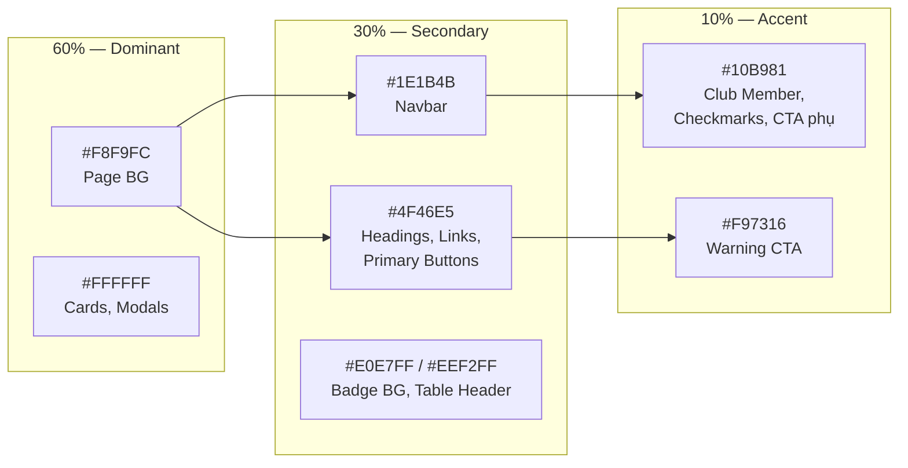

# 📐 EventFlow — Quy tắc Thiết kế UI (Design Rules)

> **Phiên bản:** 1.0  
> **Cập nhật:** 04/11/2026  
> **Framework:** Bootstrap 5.3+ · HTML/CSS thuần + CDN  
> **Layout:** Top Navbar + Full-width Content · `.container` cố định

---

## Mục lục

1. [Nguyên tắc tổng quan](#1--nguyên-tắc-tổng-quan)
2. [Bảng màu & Quy tắc 60-30-10](#2--bảng-màu--quy-tắc-60-30-10)
3. [CSS Custom Properties (Biến màu)](#3--css-custom-properties-biến-màu)
4. [Cấu trúc Layout — Bootstrap 5.3](#4--cấu-trúc-layout--bootstrap-53)
5. [Hệ thống Grid & Gutter](#5--hệ-thống-grid--gutter)
6. [Spacing (Khoảng cách)](#6--spacing-khoảng-cách)
7. [Typography (Kiểu chữ)](#7--typography-kiểu-chữ)
8. [Border Radius & Shadow](#8--border-radius--shadow)
9. [Responsive Breakpoints](#9--responsive-breakpoints)
10. [Component Guidelines](#10--component-guidelines)
11. [Dark Mode](#11--dark-mode)
12. [Accessibility Checklist](#12--accessibility-checklist)

---

## 1. 📌 Nguyên tắc tổng quan

| # | Nguyên tắc | Mô tả |
|---|-----------|-------|
| 1 | **Consistency (Nhất quán)** | Mọi trang dùng chung bảng màu, spacing, typography, border-radius. Không tự ý thêm màu/font mới |
| 2 | **Hierarchy (Phân cấp thị giác)** | Heading → Subheading → Body → Caption rõ ràng. Primary CTA nổi bật nhất trên mỗi trang |
| 3 | **Whitespace (Khoảng trống)** | Luôn giữ khoảng trống đủ rộng giữa các section, card, element. Không nhồi nhét |
| 4 | **Mobile-first** | Thiết kế từ mobile trước, scale lên desktop. Breakpoint theo chuẩn Bootstrap |
| 5 | **Accessibility** | Contrast ratio ≥ 4.5:1 cho text. Hỗ trợ keyboard navigation. Có ARIA labels |

---

## 2. 🎨 Bảng màu & Quy tắc 60-30-10

### 2.1 Quy tắc 60-30-10 là gì?

Quy tắc phân bổ màu sắc trong thiết kế, đảm bảo sự cân bằng thị giác:

```
┌───────────────────────────────────────────────────────────┐
│                                                           │
│   60% ─ DOMINANT (Nền tảng)                               │
│   Màu nền, surface, card background                       │
│   → Tạo không gian thoáng, dễ đọc                        │
│                                                           │
│   ┌───────────────────────────────────────────────┐       │
│   │                                               │       │
│   │   30% ─ SECONDARY (Cấu trúc)                  │       │
│   │   Navbar, headings, borders, icons chính       │       │
│   │   → Tạo khung, định hướng thị giác            │       │
│   │                                               │       │
│   │   ┌───────────────────────────────┐           │       │
│   │   │                               │           │       │
│   │   │   10% ─ ACCENT (Điểm nhấn)    │           │       │
│   │   │   CTA buttons, badges, links  │           │       │
│   │   │   → Thu hút hành động         │           │       │
│   │   │                               │           │       │
│   │   └───────────────────────────────┘           │       │
│   │                                               │       │
│   └───────────────────────────────────────────────┘       │
│                                                           │
└───────────────────────────────────────────────────────────┘
```

### 2.2 Áp dụng 60-30-10 cho EventFlow

| Tỉ lệ | Nhóm | Màu cụ thể | Áp dụng ở đâu |
|--------|-------|------------|---------------|
| **60%** | Dominant | `#F8F9FC` (Background) · `#FFFFFF` (Surface/Card) | Nền trang, nền card, nền form, nền modal, vùng trống |
| **30%** | Secondary | `#1E1B4B` (Navbar) · `#4F46E5` (Primary Brand) · `#E0E7FF` (Primary tint) | Navbar background, sidebar, section headings, viền active, icon primary, label badge |
| **10%** | Accent | `#10B981` (Green) · `#F97316` (Orange) | CTA buttons, badge "Club Member", checkmark, nút đăng ký, cảnh báo, link hover |

### 2.3 Bảng màu chi tiết

#### 🟣 Primary — Indigo / Purple

| Token | Hex | Vai trò |
|-------|-----|---------|
| `primary-50` | `#EEF2FF` | Background badge, hover tint nhẹ |
| `primary-100` | `#E0E7FF` | Badge background, tag background, section tint |
| `primary-200` | `#C7D2FE` | Border nhẹ cho element active |
| `primary-300` | `#A5B4FC` | Icon secondary, placeholder |
| `primary-400` | `#818CF8` | Active state, navbar link active underline |
| `primary-500` | `#6366F1` | Hover state cho primary button |
| `primary-600` | `#4F46E5` | **Màu chủ đạo — Brand color, primary button, link** |
| `primary-700` | `#4338CA` | Primary button hover (darker) |
| `primary-800` | `#3730A3` | Gradient end, dark elements |
| `primary-900` | `#312E81` | Dark variant |
| `primary-950` | `#1E1B4B` | **Navbar background, hero section, footer** |

#### 🟢 Accent — Emerald Green

| Token | Hex | Vai trò |
|-------|-----|---------|
| `accent-50` | `#ECFDF5` | Success background rất nhẹ |
| `accent-100` | `#D1FAE5` | Badge "Đã đăng ký" background |
| `accent-300` | `#6EE7B7` | Decorative elements |
| `accent-400` | `#34D399` | Hover state cho accent button |
| `accent-500` | `#10B981` | **Accent chính — Badge "Club Member", checkmark, CTA phụ** |
| `accent-600` | `#059669` | Accent button hover (darker) |
| `accent-700` | `#047857` | Text trên accent-100 background |

#### 🟠 Tertiary — Coral Orange

| Token | Hex | Vai trò |
|-------|-----|---------|
| `coral-100` | `#FFEDD5` | Warning badge background |
| `coral-400` | `#FB923C` | Warning hover |
| `coral-500` | `#F97316` | **Warning CTA, nút hành động khẩn** |
| `coral-600` | `#EA580C` | Warning button hover |

#### ⚪ Neutral — Grays

| Token | Hex | Vai trò |
|-------|-----|---------|
| `neutral-50` | `#F8FAFC` | — |
| `neutral-100` | `#F1F5F9` | Badge "Đã kết thúc" background |
| `neutral-200` | `#E2E8F0` | **Border mặc định cho card, input, table** |
| `neutral-300` | `#CBD5E1` | Divider, separator |
| `neutral-400` | `#94A3B8` | Text muted, caption, placeholder |
| `neutral-500` | `#64748B` | **Text secondary** |
| `neutral-700` | `#334155` | Text semi-bold |
| `neutral-800` | `#1E293B` | **Text primary** |
| `neutral-900` | `#0F172A` | Text heading đậm nhất |

#### 🔴 Semantic — Trạng thái

| Token | Hex | Vai trò |
|-------|-----|---------|
| `bg` | `#F8F9FC` | **Background toàn trang** |
| `surface` | `#FFFFFF` | **Card, modal, form background** |
| `success` | `#10B981` | Thành công (= accent-500) |
| `warning` | `#F59E0B` | Cảnh báo |
| `error` | `#EF4444` | Lỗi, hủy, xóa |
| `info` | `#6366F1` | Thông tin (= primary-500) |

---

## 3. 🔧 CSS Custom Properties (Biến màu)

> [!IMPORTANT]
> Tất cả các màu phải được khai báo qua CSS Custom Properties tại `:root`. Không hardcode hex trực tiếp trong component.

```css
:root {
  /* ============================================
     PRIMARY — Indigo / Purple  
     ============================================ */
  --primary-50:   #EEF2FF;
  --primary-100:  #E0E7FF;
  --primary-200:  #C7D2FE;
  --primary-300:  #A5B4FC;
  --primary-400:  #818CF8;
  --primary-500:  #6366F1;
  --primary-600:  #4F46E5;   /* ★ Brand color */
  --primary-700:  #4338CA;
  --primary-800:  #3730A3;
  --primary-900:  #312E81;
  --primary-950:  #1E1B4B;   /* ★ Navbar BG */

  /* ============================================
     ACCENT — Emerald Green  
     ============================================ */
  --accent-50:    #ECFDF5;
  --accent-100:   #D1FAE5;
  --accent-300:   #6EE7B7;
  --accent-400:   #34D399;
  --accent-500:   #10B981;   /* ★ Accent chính */
  --accent-600:   #059669;
  --accent-700:   #047857;

  /* ============================================
     CORAL — Orange (Tertiary)  
     ============================================ */
  --coral-100:    #FFEDD5;
  --coral-400:    #FB923C;
  --coral-500:    #F97316;   /* ★ Warning CTA */
  --coral-600:    #EA580C;

  /* ============================================
     NEUTRAL — Grays (Slate scale)  
     ============================================ */
  --neutral-50:   #F8FAFC;
  --neutral-100:  #F1F5F9;
  --neutral-200:  #E2E8F0;   /* ★ Border mặc định */
  --neutral-300:  #CBD5E1;
  --neutral-400:  #94A3B8;   /* ★ Text muted */
  --neutral-500:  #64748B;   /* ★ Text secondary */
  --neutral-700:  #334155;
  --neutral-800:  #1E293B;   /* ★ Text primary */
  --neutral-900:  #0F172A;

  /* ============================================
     SEMANTIC — Trạng thái  
     ============================================ */
  --color-bg:       #F8F9FC;   /* ★ Page background */
  --color-surface:  #FFFFFF;   /* ★ Card/modal BG */
  --color-success:  #10B981;
  --color-warning:  #F59E0B;
  --color-error:    #EF4444;
  --color-info:     #6366F1;

  /* ============================================
     SEMANTIC ALIASES (dùng trong component)  
     ============================================ */
  --navbar-bg:          var(--primary-950);
  --navbar-text:        #FFFFFF;
  --btn-primary-bg:     var(--primary-600);
  --btn-primary-hover:  var(--primary-700);
  --btn-accent-bg:      var(--accent-500);
  --btn-accent-hover:   var(--accent-600);
  --btn-warning-bg:     var(--coral-500);
  --btn-warning-hover:  var(--coral-600);
  --card-bg:            var(--color-surface);
  --card-border:        var(--neutral-200);
  --card-shadow:        0 1px 3px rgba(0, 0, 0, 0.08);
  --text-primary:       var(--neutral-800);
  --text-secondary:     var(--neutral-500);
  --text-muted:         var(--neutral-400);
  --input-border:       var(--neutral-200);
  --input-focus-ring:   var(--primary-400);
  --badge-primary-bg:   var(--primary-100);
  --badge-primary-text: var(--primary-600);
  --badge-accent-bg:    var(--accent-100);
  --badge-accent-text:  var(--accent-700);

  /* ============================================
     SPACING BASE  
     ============================================ */
  --space-unit:   8px;   /* Đơn vị spacing cơ sở */

  /* ============================================
     TYPOGRAPHY  
     ============================================ */
  --font-primary:   'Inter', -apple-system, BlinkMacSystemFont, 'Segoe UI', sans-serif;
  --font-mono:      'JetBrains Mono', 'Fira Code', monospace;
  --font-size-base: 1rem;       /* 16px */
  --line-height:    1.6;

  /* ============================================
     BORDER RADIUS  
     ============================================ */
  --radius-sm:    6px;
  --radius-md:    10px;
  --radius-lg:    16px;
  --radius-pill:  999px;
  --radius-circle: 50%;

  /* ============================================
     SHADOWS  
     ============================================ */
  --shadow-sm:    0 1px 2px rgba(0, 0, 0, 0.05);
  --shadow-card:  0 1px 3px rgba(0, 0, 0, 0.08);
  --shadow-md:    0 4px 6px rgba(0, 0, 0, 0.07);
  --shadow-lg:    0 10px 25px rgba(0, 0, 0, 0.1);
  --shadow-xl:    0 20px 60px rgba(0, 0, 0, 0.15);
  --shadow-primary-glow: 0 4px 12px rgba(79, 70, 229, 0.3);
  --shadow-accent-glow:  0 4px 12px rgba(16, 185, 129, 0.3);
}

body {
  font-family: var(--font-primary);
  font-size: var(--font-size-base);
  line-height: var(--line-height);
  color: var(--text-primary);
  background-color: var(--color-bg);
}
```

---

## 4. 🏗 Cấu trúc Layout — Bootstrap 5.3

### 4.1 Kiến trúc tổng thể

```
╔══════════════════════════════════════════════════════════════╗
║  NAVBAR (sticky-top)                                        ║
║  .navbar · bg: var(--navbar-bg) · height: 64px              ║
╠══════════════════════════════════════════════════════════════╣
║                                                              ║
║  ┌─ .container ────────────────────────────────────────┐    ║
║  │                                                      │    ║
║  │  BREADCRUMB (nếu có)                                 │    ║
║  │  py-2 · font-size: 14px                              │    ║
║  │                                                      │    ║
║  │  PAGE HEADER                                         │    ║
║  │  pt-4 pb-3 · <h1> + description                     │    ║
║  │                                                      │    ║
║  │  ┌─ SECTION ──────────────────────────────────────┐  │    ║
║  │  │  mb-5 · Section heading + content              │  │    ║
║  │  │                                                │  │    ║
║  │  │  ┌─ .row g-4 ──────────────────────────────┐  │  │    ║
║  │  │  │  .col-md-6 .col-lg-4   (Event Cards)   │  │  │    ║
║  │  │  │  .col-md-6 .col-lg-4                    │  │  │    ║
║  │  │  │  .col-md-6 .col-lg-4                    │  │  │    ║
║  │  │  └─────────────────────────────────────────┘  │  │    ║
║  │  └────────────────────────────────────────────────┘  │    ║
║  │                                                      │    ║
║  │  ┌─ SECTION ──────────────────────────────────────┐  │    ║
║  │  │  mb-5 · Another section                        │  │    ║
║  │  └────────────────────────────────────────────────┘  │    ║
║  │                                                      │    ║
║  └──────────────────────────────────────────────────────┘    ║
║                                                              ║
╠══════════════════════════════════════════════════════════════╣
║  FOOTER                                                      ║
║  bg: var(--primary-950) · text: white · py-5                 ║
╚══════════════════════════════════════════════════════════════╝
```

### 4.2 Quy tắc Layout

| # | Quy tắc | Chi tiết |
|---|---------|---------|
| 1 | **Container** | Luôn dùng `.container` (không dùng `.container-fluid`). Max-width theo breakpoint chuẩn Bootstrap |
| 2 | **Navbar** | Nằm ngoài `.container`. Full-width, bên trong wrap `.container` cho nội dung |
| 3 | **Content** | Mọi nội dung trang nằm trong `.container` |
| 4 | **Footer** | Full-width background, bên trong wrap `.container` |
| 5 | **Section spacing** | Mỗi section cách nhau `mb-5` (48px) |
| 6 | **Page padding** | `.container` có `py-4` (padding trên/dưới 24px) |

### 4.3 Container Max-width (Bootstrap 5.3 mặc định)

| Breakpoint | Class | Viewport | Container max-width |
|------------|-------|----------|-------------------|
| xs | — | < 576px | 100% (full-width + padding 12px mỗi bên) |
| sm | `.container-sm` | ≥ 576px | **540px** |
| md | `.container-md` | ≥ 768px | **720px** |
| lg | `.container-lg` | ≥ 992px | **960px** |
| xl | `.container-xl` | ≥ 1200px | **1140px** |
| xxl | `.container-xxl` | ≥ 1400px | **1320px** |

> [!NOTE]
> `.container` tự động chọn max-width phù hợp theo viewport. Nội dung luôn được căn giữa trang với `margin: 0 auto`.

---

## 5. 📏 Hệ thống Grid & Gutter

### 5.1 Bootstrap Grid — 12 cột

Bootstrap 5.3 sử dụng hệ thống **12 cột** (12-column grid). Mọi layout đều chia theo bội số của 12.

```
   1    2    3    4    5    6    7    8    9   10   11   12
  ┌────┬────┬────┬────┬────┬────┬────┬────┬────┬────┬────┬────┐
  │    │    │    │    │    │    │    │    │    │    │    │    │
  └────┴────┴────┴────┴────┴────┴────┴────┴────┴────┴────┴────┘
  │◄──────── col-6 ────────►│◄──────── col-6 ────────►│
  │◄──── col-4 ────►│◄──── col-4 ────►│◄──── col-4 ────►│
  │◄─ col-3 ─►│◄─ col-3 ─►│◄─ col-3 ─►│◄─ col-3 ─►│
```

### 5.2 Gutter (Khoảng cách giữa các cột)

Bootstrap 5.3 gutter mặc định: **24px** (12px mỗi bên, tức `gx-3` padding).

| Class | Gutter size | Khi nào dùng |
|-------|------------|-------------|
| `g-0` | 0px | Khi cần các cột sát nhau (gallery, grid liền mạch) |
| `g-2` | 8px | Compact layout, danh sách badge/tag nhỏ |
| `g-3` | 16px | **Mặc định Bootstrap** — Form fields, compact card grid |
| **`g-4`** | **24px** | **★ Khuyến nghị cho EventFlow** — Card grid, content sections |
| `g-5` | 48px | Spacious layout, hero sections, feature blocks |

> [!IMPORTANT]
> **EventFlow mặc định dùng `g-4` (24px)** cho tất cả card grid. Chỉ dùng `g-3` cho form layout compact, `g-5` cho hero/feature sections.

#### Gutter theo trục

| Class | Tác dụng |
|-------|---------|
| `gx-*` | Gutter ngang (horizontal) — giữa các cột |
| `gy-*` | Gutter dọc (vertical) — giữa các hàng |
| `g-*` | Cả hai trục |

### 5.3 Các layout grid phổ biến trong EventFlow

#### Layout A — Event Cards (3 cột trên desktop)

```
Desktop (≥992px):     col-lg-4 × 3
Tablet  (≥768px):     col-md-6 × 2  (card thứ 3 xuống hàng mới)
Mobile  (<768px):      col-12  × 1   (full-width, xếp dọc)

.row.g-4 > .col-md-6.col-lg-4
```

```
Desktop ≥ 992px:
┌──────────────┐  24px  ┌──────────────┐  24px  ┌──────────────┐
│  Event Card  │◄──────►│  Event Card  │◄──────►│  Event Card  │
│  col-lg-4    │        │  col-lg-4    │        │  col-lg-4    │
└──────────────┘        └──────────────┘        └──────────────┘

Tablet 768–991px:
┌────────────────────┐  24px  ┌────────────────────┐
│    Event Card      │◄──────►│    Event Card      │
│    col-md-6        │        │    col-md-6        │
└────────────────────┘        └────────────────────┘
         24px ↕
┌────────────────────┐
│    Event Card      │
│    col-md-6        │
└────────────────────┘

Mobile < 768px:
┌──────────────────────────────────────────────┐
│              Event Card (col-12)             │
└──────────────────────────────────────────────┘
         24px ↕
┌──────────────────────────────────────────────┐
│              Event Card (col-12)             │
└──────────────────────────────────────────────┘
```

#### Layout B — Event Detail (2 phần: info + sidebar)

```
Desktop (≥992px):     col-lg-8 (info) + col-lg-4 (sidebar)
Tablet  (≥768px):     col-md-7 + col-md-5
Mobile  (<768px):     col-12 + col-12  (sidebar xuống dưới)

.row.g-4 > .col-md-7.col-lg-8  +  .col-md-5.col-lg-4
```

```
Desktop ≥ 992px:
┌─────────────────────────────────┐  24px  ┌────────────────┐
│                                 │◄──────►│                │
│   Event Info                    │        │   Sidebar      │
│   col-lg-8                      │        │   col-lg-4     │
│                                 │        │   (Tham gia,   │
│   - Mô tả sự kiện              │        │    Địa điểm,   │
│   - Nội dung chi tiết           │        │    Thời gian)  │
│                                 │        │                │
└─────────────────────────────────┘        └────────────────┘
```

#### Layout C — Form đăng ký / Thông tin điểm danh

```
Centered single column:
.row.justify-content-center > .col-lg-8.col-xl-6
```

```
Desktop:
          ┌────────────────────────────────────┐
          │                                    │
          │   Form / Info Card                 │
          │   col-lg-8 col-xl-6                │
          │   (max ~570px, căn giữa)           │
          │                                    │
          └────────────────────────────────────┘
```

#### Layout D — Category Tags / Filter Bar

```
Inline flex, không dùng grid:
.d-flex.flex-wrap.gap-2   hoặc   .gap-3
```

```
┌────────┐ 8px ┌────────┐ 8px ┌──────────┐ 8px ┌────────┐
│ SPEAK  │◄───►│ DEBATE │◄───►│ CULTURE  │◄───►│  ALL   │
└────────┘     └────────┘     └──────────┘     └────────┘
```

### 5.4 Tổng hợp Grid cheat sheet

| Tình huống | Class cột | Gutter | Row class |
|-----------|----------|--------|-----------|
| Card grid 3 cột | `.col-md-6 .col-lg-4` | `g-4` | `.row.g-4` |
| Card grid 4 cột | `.col-md-6 .col-lg-3` | `g-4` | `.row.g-4` |
| Card grid 2 cột | `.col-md-6` | `g-4` | `.row.g-4` |
| Content + Sidebar | `.col-lg-8` + `.col-lg-4` | `g-4` | `.row.g-4` |
| Form centered | `.col-lg-8 .col-xl-6` | — | `.row.justify-content-center` |
| Stats/KPI 4 items | `.col-6 .col-lg-3` | `g-3` | `.row.g-3` |
| Badge/Tag row | — | — | `.d-flex.flex-wrap.gap-2` |

---

## 6. 📐 Spacing (Khoảng cách)

### 6.1 Spacing Scale (Bootstrap 5.3 Spacer = 8px base)

EventFlow sử dụng hệ thống **8px base grid** — mọi khoảng cách là bội số của 8.

| Bootstrap class | Giá trị | Pixel | Khi nào dùng |
|----------------|---------|-------|-------------|
| `*-0` | `0` | 0px | Reset spacing |
| `*-1` | `0.25rem` | 4px | Micro gap (giữa icon và text) |
| `*-2` | `0.5rem` | 8px | Padding badge, gap nhỏ giữa elements inline |
| `*-3` | `1rem` | 16px | Padding card nội bộ, gap giữa form fields |
| `*-4` | `1.5rem` | 24px | **★ Spacing chính** — Padding card, gap giữa cards, section padding |
| `*-5` | `3rem` | 48px | Gap giữa các sections, margin lớn |

> `*` = `m` (margin), `p` (padding), `mt`, `mb`, `ms`, `me`, `mx`, `my`, `pt`, `pb`...

### 6.2 Quy tắc Spacing trong EventFlow

| Vị trí | Spacing | Class Bootstrap |
|--------|---------|----------------|
| **Navbar height** | 64px | Custom CSS |
| **Page top padding** (dưới navbar) | 24px | `pt-4` |
| **Giữa page header → section đầu** | 16px | `mb-3` cho header |
| **Giữa các sections** | 48px | `mb-5` |
| **Section heading → content** | 16px | `mb-3` |
| **Card internal padding** | 24px | `p-4` |
| **Card → Card (gutter)** | 24px | `g-4` (trong `.row`) |
| **Button internal padding** | 12px top/bottom · 24px left/right | `py-2 px-4` hoặc custom |
| **Badge internal padding** | 4px top/bottom · 12-14px left/right | `py-1 px-3` |
| **Form field → field** | 16px | `mb-3` |
| **Input internal padding** | 10px top/bottom · 16px left/right | Bootstrap `.form-control` mặc định |
| **Modal body padding** | 24px | `p-4` |
| **Footer padding** | 48px top/bottom | `py-5` |

### 6.3 Vertical Rhythm (nhịp dọc)

```
Navbar          ─── 64px ───
                     24px (pt-4)
Page title      ─── auto ───
                     16px (mb-3)
Section 1       ─── auto ───
                     48px (mb-5)
Section 2       ─── auto ───
                     48px (mb-5)
Footer          ─── auto ───
```

---

## 7. 🔤 Typography (Kiểu chữ)

### 7.1 Font Stack

| Vai trò | Font | Fallback |
|---------|------|----------|
| **Primary** (mọi text) | Inter | -apple-system, BlinkMacSystemFont, 'Segoe UI', sans-serif |
| **Alternative** (heading nếu muốn) | Poppins | sans-serif |
| **Monospace** (code, ID, số liệu) | JetBrains Mono | Fira Code, Consolas, monospace |

### 7.2 Type Scale

| Element | Tag | Size | Weight | Line-height | Color | Letter-spacing |
|---------|-----|------|--------|-------------|-------|---------------|
| Display | — | 36px (2.25rem) | 700 | 1.2 | `--neutral-900` | -0.5px |
| H1 | `<h1>` | 28px (1.75rem) | 700 | 1.3 | `--neutral-800` | -0.3px |
| H2 | `<h2>` | 24px (1.5rem) | 600 | 1.35 | `--neutral-800` | 0 |
| H3 | `<h3>` | 20px (1.25rem) | 600 | 1.4 | `--neutral-800` | 0 |
| H4 | `<h4>` | 18px (1.125rem) | 600 | 1.4 | `--neutral-700` | 0 |
| Body | `<p>` | 16px (1rem) | 400 | 1.6 | `--neutral-800` | 0 |
| Body small | `<small>` | 14px (0.875rem) | 400 | 1.5 | `--neutral-500` | 0 |
| Caption | `.caption` | 12px (0.75rem) | 400 | 1.4 | `--neutral-400` | 0.2px |
| Label (Badge) | `.badge` | 13px (0.8125rem) | 600 | 1 | Depends | 0.5px |
| Overline | `.overline` | 12px (0.75rem) | 600 | 1.4 | `--primary-600` | 1px |

### 7.3 Quy tắc Typography

| # | Quy tắc |
|---|---------|
| 1 | Mỗi trang chỉ có **1 thẻ `<h1>`** |
| 2 | Heading phải theo thứ tự: H1 → H2 → H3 (không skip level) |
| 3 | Body text dùng `--neutral-800`, secondary text dùng `--neutral-500` |
| 4 | Max line-width cho body text: **75 ký tự** (~600px) để dễ đọc |
| 5 | Link text dùng `--primary-600`, hover `--primary-700` + underline |
| 6 | Label/Overline dùng `text-transform: uppercase` + letter-spacing |

---

## 8. 🔘 Border Radius & Shadow

### 8.1 Border Radius

| Element | Radius | CSS variable |
|---------|--------|-------------|
| Card | 16px | `var(--radius-lg)` |
| Button | 10px | `var(--radius-md)` |
| Input / Select | 8px | `--radius-sm` + 2px |
| Badge (pill) | 999px | `var(--radius-pill)` |
| Avatar | 50% | `var(--radius-circle)` |
| Modal | 16px | `var(--radius-lg)` |
| Tooltip | 6px | `var(--radius-sm)` |
| Category tag | 8px | `var(--radius-sm)` + 2px |

> [!WARNING]
> Không dùng `border-radius` lớn hơn 16px cho card/container. Không dùng sharp corners (0px) cho bất kỳ element nào — tối thiểu 6px.

### 8.2 Shadow Levels

| Level | Giá trị | Khi nào dùng |
|-------|---------|-------------|
| **None** | `none` | Badge, tag, inline elements |
| **SM** | `0 1px 2px rgba(0,0,0,0.05)` | Input field, dropdown item |
| **Card** | `0 1px 3px rgba(0,0,0,0.08)` | **★ Card mặc định** |
| **MD** | `0 4px 6px rgba(0,0,0,0.07)` | Card hover, dropdown menu |
| **LG** | `0 10px 25px rgba(0,0,0,0.1)` | Floating elements, popover |
| **XL** | `0 20px 60px rgba(0,0,0,0.15)` | Modal overlay |
| **Primary glow** | `0 4px 12px rgba(79,70,229,0.3)` | Primary button hover |
| **Accent glow** | `0 4px 12px rgba(16,185,129,0.3)` | Accent button hover |

---

## 9. 📱 Responsive Breakpoints

### 9.1 Bootstrap 5.3 Breakpoints

| Breakpoint | Prefix | Min-width | Target thiết bị |
|-----------|--------|-----------|-----------------|
| Extra small | — | < 576px | Điện thoại dọc |
| Small | `sm` | ≥ 576px | Điện thoại ngang |
| Medium | `md` | ≥ 768px | Tablet dọc |
| Large | `lg` | ≥ 992px | Tablet ngang / Laptop nhỏ |
| Extra large | `xl` | ≥ 1200px | Desktop |
| Extra extra large | `xxl` | ≥ 1400px | Desktop lớn |

### 9.2 Quy tắc Responsive cho EventFlow

| Element | Mobile (<768px) | Tablet (768–991px) | Desktop (≥992px) |
|---------|----------------|-------------------|-----------------|
| **Navbar** | Hamburger menu (collapse) | Full horizontal | Full horizontal |
| **Event cards** | 1 cột (col-12) | 2 cột (col-md-6) | 3 cột (col-lg-4) |
| **Detail layout** | Stack dọc | 7+5 cột | 8+4 cột |
| **Form** | Full-width | col-md-8 centered | col-lg-6 centered |
| **Page title** | 24px (1.5rem) | 28px (1.75rem) | 28–32px |
| **Card padding** | 16px (p-3) | 24px (p-4) | 24px (p-4) |
| **Section gap** | 32px (mb-4) | 48px (mb-5) | 48px (mb-5) |
| **Badge** | Wrap xuống hàng | Inline | Inline |
| **Table** | Scroll ngang (`.table-responsive`) | Full | Full |

### 9.3 Ẩn/Hiện theo Breakpoint

| Class | Hiển thị khi |
|-------|-------------|
| `.d-none .d-md-block` | Ẩn trên mobile, hiện từ tablet trở lên |
| `.d-md-none` | Chỉ hiện trên mobile |
| `.d-none .d-lg-block` | Ẩn trên mobile + tablet, hiện từ desktop |

---

## 10. 🧩 Component Guidelines

### 10.1 Navbar

| Thuộc tính | Giá trị |
|-----------|---------|
| Background | `var(--primary-950)` · `#1E1B4B` |
| Height | 64px |
| Position | `sticky-top` |
| Logo background | `var(--primary-600)` · radius 8px |
| Link color (default) | `var(--primary-100)` · `#E0E7FF` |
| Link color (active) | `#FFFFFF` + bottom border `var(--primary-400)` |
| Shadow | `0 1px 3px rgba(30, 27, 75, 0.1)` |
| Container | `.container` bên trong navbar |

### 10.2 Buttons

| Variant | Background | Text | Hover BG | Border | Radius |
|---------|-----------|------|----------|--------|--------|
| **Primary** | `--primary-600` | white | `--primary-700` | none | 10px |
| **Accent** | `--accent-500` | white | `--accent-600` | none | 10px |
| **Warning** | `--coral-500` | white | `--coral-600` | none | 10px |
| **Outlined** | transparent | `--primary-600` | `--primary-50` | 1.5px `--primary-600` | 10px |
| **Ghost** | transparent | `--neutral-500` | `--neutral-100` | none | 10px |
| **Disabled** | `--neutral-200` | `--neutral-400` | — | none | 10px |

Quy tắc:
- Padding: `12px 24px` (standard), `10px 20px` (small), `14px 32px` (large)
- Mỗi trang chỉ có **1 Primary CTA** nổi bật nhất
- Hover: thêm `box-shadow` glow tương ứng + `transform: translateY(-1px)` (tùy chọn)
- Transition: `all 0.2s ease`
- Min-width: 120px cho button đơn, full-width cho form submit trên mobile

### 10.3 Cards

| Thuộc tính | Giá trị |
|-----------|---------|
| Background | `var(--card-bg)` · `#FFFFFF` |
| Border | `1px solid var(--card-border)` · `#E2E8F0` |
| Border-radius | `var(--radius-lg)` · 16px |
| Padding | `p-4` (24px) |
| Shadow (default) | `var(--shadow-card)` |
| Shadow (hover) | `var(--shadow-md)` + border-color → `--primary-200` |
| Transition | `all 0.2s ease` |
| Image (nếu có) | `border-radius: 16px 16px 0 0` (top corners) |

Variant đặc biệt:
- **Card with left accent**: `border-left: 4px solid var(--primary-600)` — dùng cho info card, thông tin điểm danh
- **Card highlighted**: `border-color: var(--primary-400)` + `box-shadow: var(--shadow-primary-glow)` — sự kiện đang diễn ra

### 10.4 Badges / Tags

| Variant | Background | Text color | Ý nghĩa |
|---------|-----------|-----------|---------|
| **Primary** | `--primary-100` | `--primary-600` | Label category (SPEAK, DEBATE) |
| **Accent** | `--accent-100` | `--accent-700` | Đã đăng ký, thành công |
| **Accent solid** | `--accent-500` | white | Club Member |
| **Warning** | `--coral-100` | `--coral-500` | Sắp hết hạn |
| **Neutral** | `--neutral-100` | `--neutral-500` | Đã kết thúc |
| **Info** | `--primary-50` | `--primary-500` | Sắp diễn ra |

Shape: `border-radius: var(--radius-pill)` (999px) · Padding: `4px 12px`

### 10.5 Form Elements

| Thuộc tính | Giá trị |
|-----------|---------|
| Border | `1px solid var(--input-border)` · `#E2E8F0` |
| Border-radius | 8px |
| Padding | `10px 16px` |
| Focus border | `var(--primary-400)` · `#818CF8` |
| Focus ring | `0 0 0 3px rgba(79, 70, 229, 0.15)` |
| Label | `font-size: 14px` · `font-weight: 600` · `color: var(--neutral-700)` · `mb-1` |
| Error border | `var(--color-error)` · `#EF4444` |
| Error text | `font-size: 12px` · `color: var(--color-error)` · `mt-1` |

### 10.6 Tables

| Thuộc tính | Giá trị |
|-----------|---------|
| Header BG | `var(--primary-50)` · `#EEF2FF` |
| Header text | `var(--primary-600)` · `font-weight: 600` · `font-size: 13px` · `text-transform: uppercase` |
| Row border | `1px solid var(--neutral-200)` |
| Row hover | `var(--neutral-50)` |
| Row striped (tùy chọn) | `var(--neutral-50)` xen kẽ |
| Cell padding | `12px 16px` |
| Responsive | Wrap bằng `.table-responsive` |

### 10.7 Modals

| Thuộc tính | Giá trị |
|-----------|---------|
| Backdrop | `rgba(15, 23, 42, 0.5)` + `backdrop-filter: blur(4px)` |
| Background | `var(--color-surface)` |
| Border-radius | 16px |
| Shadow | `var(--shadow-xl)` |
| Max-width | 560px (default), 720px (large) |
| Header border | `1px solid var(--neutral-200)` |
| Padding | `p-4` (24px) |

### 10.8 Checkmark / Success Indicator

| Thuộc tính | Giá trị |
|-----------|---------|
| Container | Circle, 48px × 48px |
| Background | `var(--accent-500)` |
| Icon color | white |
| Icon size | 24px |

---

## 11. 🌙 Dark Mode

> [!NOTE]
> Dark mode chuyển đổi bằng class `.dark` trên `<html>` hoặc `[data-bs-theme="dark"]` (Bootstrap 5.3 native).

| Token | Light value | Dark value |
|-------|-----------|-----------|
| `--color-bg` | `#F8F9FC` | `#0F0E1A` |
| `--color-surface` | `#FFFFFF` | `#1C1B2E` |
| `--navbar-bg` | `#1E1B4B` | `#0A0919` |
| `--primary-600` | `#4F46E5` | `#818CF8` (sáng hơn) |
| `--accent-500` | `#10B981` | `#34D399` |
| `--text-primary` | `#1E293B` | `#E2E8F0` |
| `--text-secondary` | `#64748B` | `#94A3B8` |
| `--card-border` | `#E2E8F0` | `#2D2B55` |
| `--neutral-200` | `#E2E8F0` | `#2D2B55` |
| `--input-border` | `#E2E8F0` | `#3D3A6E` |

---

## 12. ✅ Accessibility Checklist

| # | Yêu cầu | Tiêu chuẩn |
|---|---------|-----------|
| 1 | **Contrast ratio text** | ≥ 4.5:1 (WCAG AA) — `#1E293B` trên `#FFFFFF` = ✅ 13.6:1 |
| 2 | **Contrast ratio large text** | ≥ 3:1 — `#4F46E5` trên `#FFFFFF` = ✅ 4.6:1 |
| 3 | **Focus visible** | Tất cả interactive elements phải có visible focus ring |
| 4 | **Keyboard navigation** | Tab order hợp lý, Enter/Space kích hoạt buttons |
| 5 | **ARIA labels** | Buttons chỉ có icon phải có `aria-label` |
| 6 | **Alt text** | Mọi `` phải có `alt` mô tả |
| 7 | **Color không phải cách duy nhất** | Trạng thái phải có text/icon kèm theo, không chỉ dùng màu |
| 8 | **Touch target** | ≥ 44px × 44px cho mobile |
| 9 | **Reduced motion** | Tôn trọng `prefers-reduced-motion` |

---

## Phụ lục — Tổng quan Visual



> [!TIP]
> Khi review bất kỳ trang nào, nheo mắt (squint test) nhìn tổng thể: **nền trắng/xám** phải chiếm phần lớn diện tích, **tím** tạo khung cấu trúc, **xanh lá/cam** chỉ xuất hiện ở vài điểm nhấn quan trọng.
